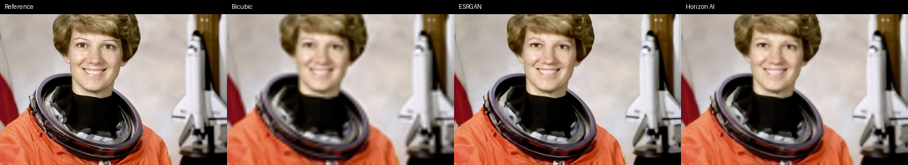
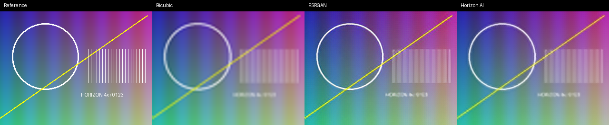

# Horizon AI — local still-image super-resolution

Horizon AI performs real pretrained ESRGAN inference on the CPU. It creates a new 4× image from a bounded input or a native-pixel crop. It does not recover ground truth, replace optical zoom, guarantee legible invented text, or reproduce proprietary Pixel processing. It is not a live video pipeline. Input/output processing needs no network permission.

## Model identity and redistribution

Bundled file: `app/src/main/assets/ai/ESRGAN.tflite`.

- Size: **4,993,712 bytes**.
- SHA-256: `1a380d3744103e11ef343534aaff54815cae40769dcd00c023652a7e5bc47f4b`.
- Official [Google download](https://storage.googleapis.com/download.tensorflow.org/models/tflite/esrgan/ESRGAN.tflite), used by the TensorFlow [sample download script](https://github.com/tensorflow/examples/blob/master/lite/examples/super_resolution/android/app/download.gradle).
- The [official sample README](https://github.com/tensorflow/examples/blob/master/lite/examples/super_resolution/android/README.md) identifies the TFHub captain-pool ESRGAN implementation. The current [model card](https://www.kaggle.com/models/kaggle/esrgan-tf2/tfLite/esrgan-tf2/1) has a corresponding LiteRT variation.
- Verified 2026-11-20: the public [Kaggle metadata API](https://www.kaggle.com/api/v1/models/list?search=esrgan-tf2) declares **MIT** for model169, tfLite instance1184, version1, uncompressed size4,993,712. Downloading that exact variation produces `1.tflite` with the same SHA-256 as Google's file. This establishes an exact binary link, rather than assuming a model inherits the example app's license.
- Preserve `assets/ai/LICENSE_ESRGAN_MIT.txt` (Copyright2020 AdrishDey) and `NOTICE_ESRGAN.json`, which records the source URLs, hash, and exact upstream variation metadata. The [upstream MIT text](https://github.com/captain-pool/GSOC/blob/master/LICENSE) is bundled unchanged.
- The model's MIT terms are distinct from the Apache-2.0 TensorFlow sample and LiteRT runtime code. Other models mentioned below are **not bundled**.

## Architecture and tensor contract

This is an [ESRGAN](https://arxiv.org/abs/1809.00219) family GAN generator using residual/dense convolution blocks and learned upsampling. The shipped mobile graph was introspected:169 `CONV_2D`,136 `LEAKY_RELU`,132 `CONCATENATION`,47 `ADD`,11 `MUL`, and2 `TRANSPOSE_CONV` operators. Do not equate its small mobile architecture with every full-size ESRGAN checkpoint.

Input: `input_0`, **FLOAT32 RGB [1,50,50,3]**, values **0..255**, no mean/std normalization. Output: `Identity`, **FLOAT32 RGB [1,200,200,3]**, clipped to0..255. Although the upstream SavedModel card describes flexible images, this exact LiteRT conversion has a fixed50×50 signature. Runtime code checks dtype, both shapes, tensor count and the exact asset hash, and fails if they differ.

The upstream card declares training on **bicubically downsampled DIV2K**. Real camera noise, motion blur, demosaicing artifacts, compression, faces and text can therefore lie outside its training degradation. Generated detail can be plausible but wrong.

## Android API and sizing

Use `implementation("com.google.ai.edge.litert:litert:1.4.2")`, the [official Interpreter branch](https://ai.google.dev/edge/litert/android), with `org.tensorflow.lite.Interpreter` and CPU execution. No GPU, Play Services or network runtime is required. Do not mix it with the old `org.tensorflow:tensorflow-lite` artifact.

```kotlin
val result = HorizonAi.infer(
    context,
    uprightSoftwareBitmap,
    onProgress = { p -> /* post p.completedTiles / p.totalTiles to UI */ },
    isCancelled = { cancellationRequested },
    options = AiOptions(maxInputLongEdge = 640)
)
// result.bitmap belongs to the caller; inspect result.metrics for actual sizing/time.
```

Call synchronously on a worker. Input is already EXIF-oriented and software allocated by the caller. The core never recycles caller input. It downsizes only when the source exceeds the configured cap, preserving aspect; output is exactly **processed input width×4 and height×4**. Default cap640; supported cap64..768. Thus a4000×3000 source becomes640×480 →2560×1920, rather than silently claiming full48MP processing. For detail-crop mode, supply a256..384-pixel crop from native decoded pixels:256×256 →1024×1024 retains that crop's original sampling. The caller owns crop selection and must label its extent.

`AiOptions` also exposes `strength=0.65`, `preserveChroma=true`, `threads=2` (1..4), and `memoryBudgetMiB=192` (96..256). `AiResult` contains `bitmap` and `metrics`:source/input/output dimensions, actually completed/total tiles, elapsed worker time, estimated peakMiB, noise estimate, edge fraction and tensor description. Output is SDR8-bit sRGB ARGB_8888; HDR/wide-gamut metadata is not preserved by this image path.

## Tiling, color, cancellation and memory

Every model call receives a50×50 tile. A9-pixel context halo is excluded from each side, leaving a32×32 core; cores advance24 source pixels, overlap8, and blend with normalized positive feather weights. Global edges use reflect-101 mirrored samples. These finite halos reduce boundary artifacts but do not encompass the entire deep network receptive field; visible seams remain possible on difficult textures.

A global Catmull-Rom bicubic baseline supplies stable coordinates/color. Learned luminance is mixed at a conservative strength, reduced in noisy flat areas; by default only15% of the corresponding learned chroma change is used. This reduces color shifts and hallucination strength; it is not a separately trained denoiser. The flat-region Laplacian noise proxy and edge fraction are scene heuristics, not calibrated ISO/noise measurements.

The progress callback starts at0 and advances only **after a real interpreter invocation and composition completes**. Cancellation is checked before/after each invocation and during composition. It throws `CancellationException`; partial bitmaps are recycled and never returned. A running CPU invocation cannot be interrupted through the callback, so cancellation latency includes one tile. The caller must prevent overlapping inference jobs; two simultaneous interpreters would multiply memory/time.

The preflight estimate includes caller input allocation, optional resized copy, input pixels, output bitmap, full output weight plane,12MiB scratch/model-copy allowance, plus a conservative96MiB native runtime reserve. It rejects work above the requested budget or75% of the VM max heap. Example estimates:640-square161.1MiB;768-square184.5MiB. This is an **estimate**, not an enforced native allocator ceiling; fragmentation/runtime/device differences can still cause OOM. Desktop process working-set growth measured about55.3MiB after allocation/inference for this fixed model; Android memory and performance are unverified. The CPU Interpreter is closed and owned temporary bitmaps are recycled on success, cancellation or failure.

## Reproducible offline evidence

Run with Python3.12; tested package versions:ai-edge-litert2.4.0, numpy2.5.5, Pillow13.0.0, scikit-image0.26.0. The desktop Python runtime version intentionally differs from the Android Interpreter1.4.2 branch; this validates model execution and algorithmic behavior, **not Android JNI/device parity**.

```powershell
py -3.12 -m venv ../ai-venv
../ai-venv/Scripts/python.exe -m pip install ai-edge-litert==2.4.0 numpy==2.5.5 pillow==13.0.0 scikit-image==0.26.0
../ai-venv/Scripts/python.exe app/src/test/python/ai_benchmark.py --native-crop --out ../ai-validation
```

No network is used by the benchmark itself. Its synthetic fixture is generated in source. The natural fixture uses the scikit-image bundled [NASA astronaut image](https://scikit-image.org/docs/stable/api/skimage.data.html#skimage.data.astronaut), public domain; the exact crop and downsampling are in the script. The checked-in inputs and comparisons are under `app/src/test/resources/ai/`, alongside `benchmark.json`; add `--all-images` to save all full intermediate PNGs in scratch.

Real measured CPU/XNNPACK inference,2 threads, on this Windows desktop:

| Fixture | Input → output | Completed tiles | Worker wall time | Bicubic PSNR/SSIM | Raw ESRGAN PSNR/SSIM | Default Horizon AI PSNR/SSIM |
|---|---|---:|---:|---|---|---|
| Synthetic lines/text/gradient |80×60 →320×240|9/9|0.847s|21.0997 /0.77921|22.2809 /0.79080|21.9632 /0.81170|
| NASA astronaut crop |96×64 →384×256|12/12|1.203s|26.0346 /0.82457|27.8700 /0.86346|28.1913 /0.87755|
| Native256-pixel crop |256×256 →1024×1024|121/121|18.996s|No high-resolution ground truth|Not a fidelity score|AI-vs-bicubic mean absolute difference2.103/255|

Metrics use RGB, range255, full image without border shaving, and scikit-image PSNR/SSIM. The default mixes actual model predictions with bicubic; “raw ESRGAN” uses the same overlapping tile assembly without conservative color mixing. Python/Kotlin8-bit rounding can differ by about one code value. These two downsampled fixtures show a benefit over bicubic; they are a small reproducible sanity check, not a camera dataset validation or a promise of improvement. The native crop establishes real inference at a useful crop size, but has no higher-resolution reference. Large whole-frame jobs can take minutes on phones. No S24 or other handset latency/thermal/quality validation has been performed.

Representative comparisons (reference, bicubic, raw model, default output):





JVM tests cover complete/overlapping tile coverage, reflected boundaries, feather normalization, explicit capped sizing, memory estimates, bicubic flat-color preservation, chroma limits and noise-protection behavior. The benchmark performs actual model inference; JVM geometry tests alone do not.

## Why this model, and alternatives

| Candidate | Appropriate role | Tradeoff for this Android milestone |
|---|---|---|
| Bundled Google mobile ESRGAN |Small verified4× model, straightforward CPU tensor contract|Already converted/redistributable; fixed50px tile limits context and incurs many calls; trained on bicubic degradation|
| [Real-ESRGAN](https://github.com/xinntao/Real-ESRGAN) |Practical general restoration/SR using synthetic real-world degradations|Potentially better camera-degradation fit; checkpoint-specific conversion, mobile memory/operator validation and weight-license verification would be a separate milestone. No comparative run here|
| [SwinIR](https://github.com/JingyunLiang/SwinIR) |Transformer-based SR/denoising/restoration variants|Attention/window handling and checkpoint choice add conversion/tiling cost; no mobile performance or comparative run here|
| [NAFNet](https://github.com/megvii-research/NAFNet) |Activation-free image restoration, notably denoising/deblurring|A restoration checkpoint is not automatically a4× SR model; NAFSSR is a separate stereo-SR design. It could precede SR after explicit training/domain/latency validation; not bundled or tested|

Optical reach, multi-frame fusion, demosaicing and handset ISP integration are separate from this single-image model. Future replacement requires a model-specific license/hash/tensor contract, memory profiling, real-camera held-out evaluation and Android physical-device tests.
